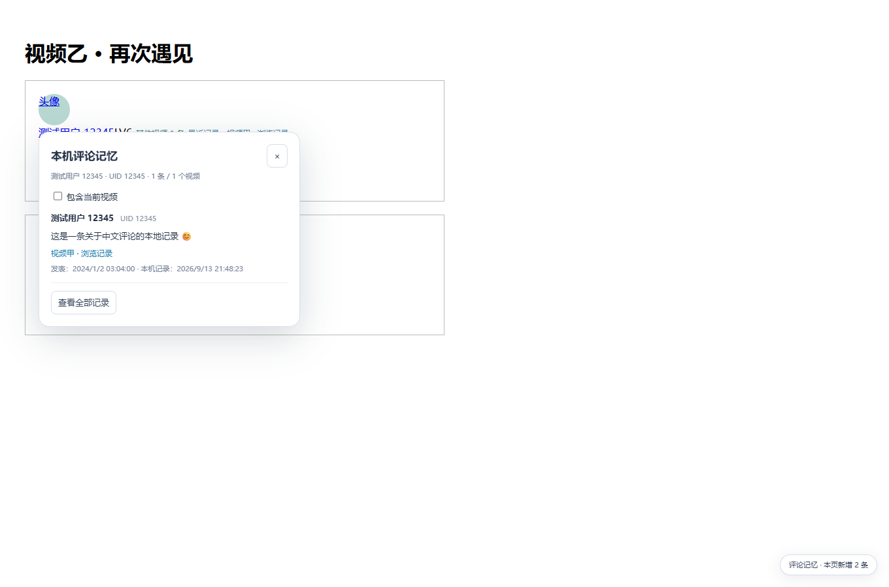
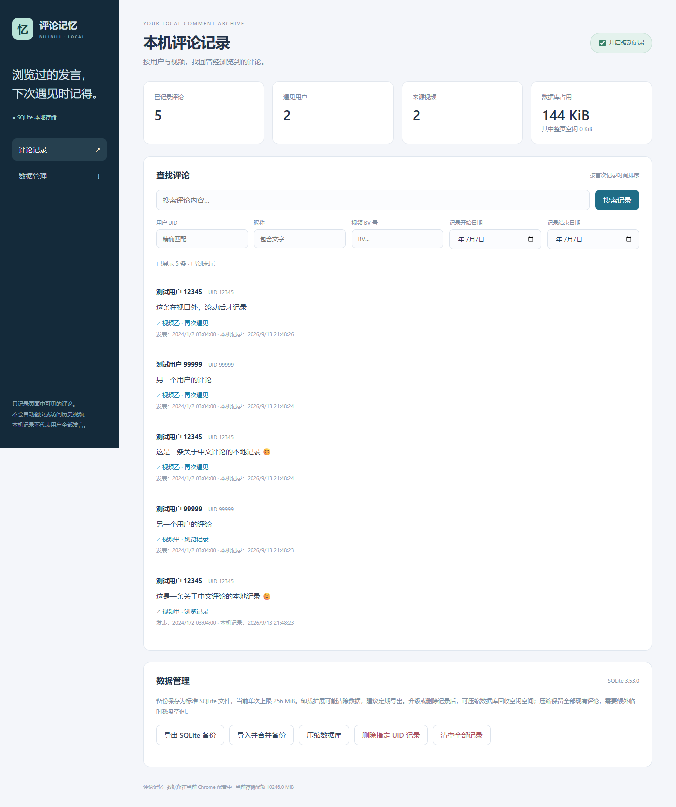

# BiliMemo · B 站评论记忆

**浏览时记录，遇见时回看。**

[](https://github.com/wzp100/bili-comment-memory/actions/workflows/ci.yml)
[](https://github.com/wzp100/bili-comment-memory/releases/latest)
[](LICENSE)

一个为桌面 Chrome / Edge 设计的开源扩展：正常浏览 B 站视频评论区时，把进入视口的评论保存到本机 SQLite。以后遇到同一位用户，悬浮头像即可回看本机已记录的跨视频发言。

[下载安装](https://github.com/wzp100/bili-comment-memory/releases/latest) · [安装指南](docs/INSTALL.md) · [详细用法](docs/USAGE.md) · [问题反馈](https://github.com/wzp100/bili-comment-memory/issues) · [更新记录](CHANGELOG.md)

> 独立社区项目，与哔哩哔哩官方无隶属关系。本机记录只覆盖你浏览过的可见评论，不代表任何用户的完整历史。当前通过 GitHub Releases 分发，尚未上架浏览器扩展商店。

## 可以做什么

- **被动记录**：只记录前台页面进入视口的评论，不自动翻页、展开回复或抓取用户空间。
- **跨视频回看**：悬浮头像查询历史；评论旁显示其他视频记录条数与最近记录的视频链接。
- **本地搜索**：按 UID、昵称、BV 号、正文和记录日期筛选。
- **数据管理**：暂停记录、删除用户记录、清空、整理数据库，以及 SQLite 导入导出。
- **数据留在本机**：没有云端同步、遥测或远程执行代码；全部脚本和 SQLite WASM 随包分发。

## 界面预览

以下截图由模拟评论生成，不含真实用户的评论数据。



<details>
<summary>查看本地评论库</summary>



</details>

## 安装

1. 在 [Releases](https://github.com/wzp100/bili-comment-memory/releases/latest) 下载 `bili-comment-memory-版本号.zip`，不要选 **Source code**。
2. 解压到长期保留的固定目录，确认目录里直接有 `manifest.json`。
3. 打开 `edge://extensions` 或 `chrome://extensions`，开启「开发者模式」，点击「加载已解压的扩展程序」，选择该目录。
4. 刷新 B 站普通 BV 视频页，正常浏览评论区即可。

安装使用不需要 Node.js。更新前先导出备份，再把新包覆盖到原目录并重新加载；不要先卸载旧扩展。切换到不同路径或未来商店版本时，扩展 ID 可能变化，需通过备份迁移。当前单次导入导出上限 **256 MiB**，超过上限请保留原安装路径。更多说明见 [安装与迁移](docs/INSTALL.md)。

## 使用范围

当前支持桌面普通 BV 视频页，不支持番剧、直播、动态、移动版及无痕窗口。最低 API 目标为 Chromium 116；自动测试使用 Playwright Chromium，历史实测包含 Chrome 152，具体 Edge 兼容性需以实际版本验证为准。

只保存本机看到的内容，不会补抓安装前的历史。评论被折叠、页面字段缺失或网站改版可能影响记录；缺少评论 ID 时采用指纹去重。链接打开原视频，暂不定位具体评论。详见 [已知限制](docs/USAGE.md#当前限制)。

## 开发

Node.js **22.18+**，推荐 **24 LTS**。

```sh
git clone https://github.com/wzp100/bili-comment-memory.git
cd bili-comment-memory
npm ci
npm run check
npm test
npm run package
npm run verify:package
```

加载生成的 `dist` 目录进行调试；可分发 ZIP 与 SHA-256 位于 `output/releases`。构建会重建 `dist`，请勿把手工文件放进去。

浏览器测试使用独立配置和模拟页面：

```sh
npx playwright install chromium
npm run verify:browser
```

Windows / Linux CI 自动执行检查、测试、构建和包校验；Linux CI 额外验证 Chromium 中的完整流程。真实站点验证和性能基准按需运行，见 [贡献指南](CONTRIBUTING.md) 与 [性能记录](PERFORMANCE.md)。

## 文档与维护

| 文档                             | 内容                           |
| -------------------------------- | ------------------------------ |
| [使用说明](docs/USAGE.md)        | 查询、备份、故障恢复和功能限制 |
| [架构说明](docs/ARCHITECTURE.md) | 模块职责、消息流和数据库约束   |
| [参与贡献](CONTRIBUTING.md)      | 开发环境、修改约定和测试       |
| [维护与发布](docs/RELEASING.md)  | 版本号、CI、标签与自动 Release |
| [隐私说明](PRIVACY.md)           | 数据、权限、存储与删除         |
| [安全报告](SECURITY.md)          | 私密漏洞报告渠道               |

欢迎通过 Issue 提供复现步骤或功能建议，通过 Pull Request 贡献改进。

## 许可证

项目代码采用 [MIT License](LICENSE)。随包分发的 SQLite WASM 使用其自身许可证，详见 [第三方声明](public/THIRD-PARTY-NOTICES.txt) 和 [SQLite WASM 许可证](public/SQLITE-WASM-LICENSE.txt)。项目许可证不改变评论内容及第三方品牌的权利归属。
